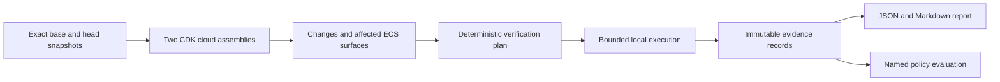

# Architecture decisions

## Product boundary

The user is a developer reviewing a concrete change before deployment. The first job is to catch an application startup regression introduced through CDK task configuration and explain exactly what ran. The differentiator is the connection from change to property to conditions to observations and gaps, not the number of tools run.

Use a TypeScript/Node core because CDK, the first users, and the Node Testcontainers integration share that ecosystem. Keep a single package with internal modules. Do not start with a service, database, SDK marketplace, or distributed scheduler.

## Revision and input contract

Resolve refs to commit SHAs at the start; compare the exact base/head trees rather than silently choosing a merge base. Record both and reject missing objects. The first version verifies committed inputs; dirty files are excluded with a visible notice. Later adapters must explicitly select PR base and merge/head semantics.

Use separate temporary snapshots; do not reset or modify the user's checkout. Pin runtime, package manager, lockfile, CDK, adapter, provider schemas, and validator rules. Freeze CDK context, account/region parameters, synthesis command, and environment allowlist. No implicit AWS context lookups, bootstrap, deploy, change-set creation, or asset publishing. Compare **two synthesized assemblies**, rather than using a default `cdk diff` against a deployed stack.

Run trusted repository commands with no inherited AWS credentials or credential-file mounts. Support offline execution after dependencies and images have been prepared. Executing CDK is executing code; a temporary directory and stripped credentials do not constitute a hostile-code sandbox. Require sandboxed runners before supporting untrusted forks in CI.

If identical recorded inputs synthesize differently, preserve both artifacts and report nondeterminism/incomplete analysis. Full-tree fingerprints are the conservative first invalidation rule. Narrowing them requires evidence of complete dependency mapping.

## Change model and selection

Use assembly stack identifiers and full nested-stack paths plus logical IDs as identities. Keep original templates and JSON-pointer locations. Track task definition, service references, image/assets, environment, secrets/environment files, command/entrypoint, health check, runtime platform, roles, networking, dependency references, deployment configuration, and deletion/update policies.

Build a small reference graph from `Ref`, `GetAtt`, `Sub`, outputs/parameters, nested assembly artifacts, and explicitly configured surface dependencies. Preserve intrinsic expressions when unresolved. Resolve only supported deterministic expressions with known values; never fabricate physical IDs, secret contents, or account configuration.

Changing shared CDK code, context, dependencies, parameters, image inputs, verification configuration, or an unresolved dependency reruns the relevant selected scope. If impact cannot be bounded, broaden to all configured ECS surfaces and explain the reason. Unknown mapping, removed tasks, ambiguous logical-ID changes, custom transforms/resources, and absent nested templates yield gaps; they do not become an empty successful plan.

Treat logical-ID changes as remove/add unless there is an explicit, evidenced mapping. Use pinned resource-schema update semantics to flag possible replacements; local analysis cannot guarantee a deployed replacement decision. Detect deletions and retention-policy changes even when there is no head container to run. Nested-stack inventory is in scope; simulating its rollback is not.

## Small evidence record

A record contains these fields; the schema is to be implemented in roadmap issue 03:

| Field | Meaning |
| --- | --- |
| `schemaVersion`, `id`, `runId` | Versioned record identity and execution grouping |
| `property` | Stable ID, precise assertion, surface ID, applicability and conditions |
| `revisions` | Repository identity, exact base/head SHAs, side tested |
| `inputs` | Tree/lockfile/context/template/contract/config fingerprints, resolved image digest, substitution identities |
| `producer` | Testificate, adapter, tool, runtime, schema and rules versions/digests; redacted command/config |
| `environment` | Static/local Docker/emulator/real AWS; OS/architecture, Docker identity, capability-profile version |
| `outcome`, `reason` | Result and structured explanation |
| `artifacts` | Relative content-addressed logs, template/plan/report locations and checksums |
| `startedAt`, `finishedAt`, `limitations` | Observation time and explicit limits |
| `freshness` | Derived fresh/stale/unknown classification with reasons; original observation preserved |

Results are `demonstrated`, `failed` (valid execution contradicted the assertion), `error` (execution/tool/precondition failed), `skipped` (deliberately not run), `unverifiable` (property cannot be established here), or `unsupported` (adapter cannot represent/execute the requested behavior). Staleness is orthogonal to the original result. Missing Docker is an error; unknown intrinsics are a verification gap; an observed early process exit is a failed startup property. A timeout is a failed property only when the execution was valid and the asserted readiness deadline expired; a broken runner is an error.

A pass from a container-health or HTTP probe demonstrates that assertion for that image/configuration, during that observation interval. It does not prove continued reliability, Fargate IAM/network behavior, ALB routing, AWS secret injection, scheduler behavior, or rollback.

Artifacts must redact secrets before writing. Do not expose hashes of low-entropy secrets in distributable reports. Use non-secret substitution IDs and a local keyed fingerprint or revisioned secret-provider identity; if freshness cannot be checked safely, mark it unknown and rerun. Local records are reproducibility aids, not tamper-proof attestations. Signing and in-toto/SLSA export are later interoperability choices.

## Runtime and readiness

Use a pinned Linux image digest or a selected local image ID. v0.1 can test an unchanged image across an infrastructure-only configuration change; if a local image overrides a CDK asset, the report must say which mapping the user asserted and cannot claim a CDK asset build was verified. Changed/unmapped image assets remain gaps until independently mapped and built.

Translate only supported task fields to Docker. Block readiness execution if a changed field that can affect startup cannot be faithfully represented; expose that gap rather than silently dropping it. Contract-defined test substitutes are explicit conditional evidence. Require readiness plus a bounded stability interval, distinguish process exit, probe failure, image pull failure and harness error, and record base/head outcomes separately. Base failure prevents attributing a regression to this change but does not erase the head observation.

Use run-specific containers/networks, time/resource limits, explicit endpoint allowlists, synthetic credentials, no host filesystem mounts, and cleanup on success, failure, cancellation and timeout. Test workload containers do not receive the Docker socket. Emulator compute tests may require socket access; keep that adapter opt-in and record its trust boundary.

## Policy and configuration weakening

Keep evidence production separate from policy. A named local policy requires applicable startup/readiness and configured static properties to have fresh demonstrated evidence. Output `pass`, `fail`, or `incomplete` with requirements/gaps listed. Exit codes: 0 for named-policy pass, 1 for valid evidence failing policy, 2 for incomplete execution/configuration/evidence. Mixed failures and errors remain visible even when exit code 2 takes precedence.

Compare base/head verification contracts, commands, tools, suppressions, scopes, readiness deadlines and stability intervals. Head-only removal of checks or weakened assertions cannot silently change the baseline. Use the baseline requirement floor and surface the weakening; any externally supplied waiver needs a reason and provenance and never becomes demonstrated evidence. Newly added head surfaces require the declared head contract as well. A missing baseline config uses documented built-in defaults. Preserve unsupported/unverifiable properties even if they are outside the named local policy.

Tests and code changed together can share a mistaken assumption regardless of author. Show contract/test changes and stable oracle sources; retain independent negative controls. Do not infer independence from a second agent or turn coverage/complexity into proof. Mutation/contract testing is research-gated later.

## Emulator capability profile

Version the profile against the emulator image digest, module version and Testificate adapter. Each entry identifies API/behavior, preconditions, claim scope, documentation/source reference, runnable test ID/artifact, observation date, and limitations. Classifications: `documented`, `api-compatible`, `behavior-demonstrated-local`, `behavior-compared-with-aws`, `unsupported`, `unknown`. These are distinct evidence categories, not an ordinal score.

Only a recorded local execution earns local behavioral evidence. Only a recorded comparison in AWS earns the AWS-comparison category, bounded by the tested region/platform/scenario. Documentation and unit tests with mocked launch outcomes never establish AWS parity. Conflicting docs/source/tests reduce the claim to unknown pending investigation. Pin and requalify upgrades; never inherit a capability result across image changes.

## Adapters later

CI wraps CLI execution and publishes the existing bundle. A later MCP adapter exposes structured reports and plans; it does not create an LLM planner in the core. No daemon, hosted dashboard, multi-language analyzer collection, generic plugin loading, cloud costs, or autonomous deployment is required for v0.1.
